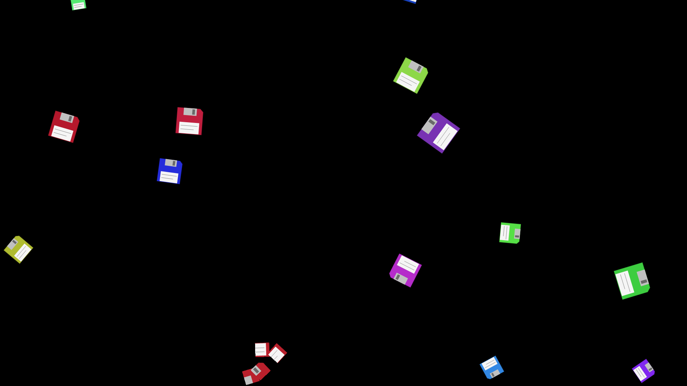

# Falling Components ScreenSaver
A falling computer components ScreenSaver for Windows

## 👤 Author

* [@remusrigo](https://github.com/RemusRigo)
* [@remusrigo](https://sourceforge.net/u/remusrigo/profile)

## ✨ Features

* Floppy disks, CD-ROMs, cassette tapes, hard disks, CPUs and memory modules fall and spin down the screen
* Items break into four pieces that bounce away when they hit the bottom of the screen

## ⚙️ User's Guide

See the [User's Guide](Users%20Guide.md) for downloads, runtimes, installation and settings.

## 🛠️ Statistics

 

## 🗺️ Roadmap

* 2026-11-25: Add: [Floppy Disk icon](https://www.flaticon.com/free-icon/floppy-disk_17138366) by [Bahu Icons](https://www.flaticon.com/authors/bahu-icons)
* 2026-11-25: Add: Settings form: Everything Random, Random Color, Colors, Random Objects (One / All), Objects, Speed
* 2026-11-25: Add: CD-ROM, Hard Disk, CPU, Memory class
* 2026-11-24: Add: Fragment: a class that describes a single flying quarter after the break has already happened
* 2026-11-24: Add: MediaItem: a class that describes one falling object
* 2026-11-24: Add: FDD (floppy disk) class
* 2026-11-24: Project started
